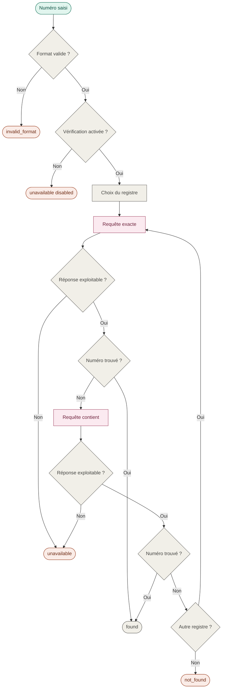

# Conception : `benin-business-id` pour Python

**Statut** :
- choix de l'utilisateur recueillis le 22/10/2026 (P1 à P13, §2) ;
- relecture de Codex (gpt-6.1-sol, effort ultra) le même jour, à la demande de l'utilisateur, puis arbitrages P14 à P16 ;
- alignement sur le port France décidé ensuite (P17) ;
- le reste du document applique ces choix ; les sept points du §14 ont été validés le 22/10/2026, avant l'implémentation.

**Référence** : le package PHP terminé `egbavou/benin-business-id`, dans `../benin-business-id/` :
- `docs/research/benin-ifu-rccm.md`, décisions D1 à D36 ;
- `docs/design/benin-business-id-spec.md` ;
- `src/` et `tests/`.

**Exigence centrale.** Pour une même entrée, le port Python doit donner exactement les mêmes résultats que le PHP :
- mêmes règles de format et mêmes raisons d'échec ;
- mêmes statuts de vérification et causes d'indisponibilité, `failure` compris ;
- mêmes requêtes vers l'APIEx, même décodage, mêmes cas d'erreur ;
- mêmes vecteurs de test.

**Ce qui fait foi :**
- le code PHP, quand ce document ne précise pas un comportement ;
- pour la partie HTTP, le PHP **avec Guzzle**, appelé par `sendRequest()` en PSR-18. C'est ce que construit l'intégration Laravel et ce que recommande le README PHP ;
- pour les types, le PHP appelé en `strict_types`.

Les seuls écarts admis sont listés au §12.

> **Langue.** Ce document est en français. Tout ce qui est écrit dans le dépôt est en anglais : code, identifiants, commentaires, messages, tests, README. Seule exception : le catalogue de traduction français de Django.

---

## 1. Périmètre

Identique au PHP.

**Le package fait :**
- la validation hors ligne du format de l'IFU et du RCCM ;
- la vérification d'existence d'un RCCM dans l'annuaire public de l'APIEx, désactivée par défaut ;
- un vérificateur d'IFU sans source, qui renvoie `UNAVAILABLE` / `NO_SOURCE` ;
- des intégrations Django (validateurs) et Pydantic (types de champ), facultatives.

**Le package ne fait jamais :**
- d'appel réseau pendant une validation de format ;
- d'interrogation de `ifu.impots.bj`, ni d'aucune page protégée par CAPTCHA ;
- de calcul de clé de contrôle IFU ;
- de lecture des champs `Prénom` et `Nom` de l'annuaire.

**Données personnelles.** Le masquage dépend du registre, comme en PHP (D14, D27) :
- résultat venu du registre des établissements : ni nom, ni téléphone, ni e-mail ;
- résultat venu du registre des sociétés : renvoyé tel que l'APIEx le publie, y compris pour un numéro de catégorie A ou E.

---

## 2. Décisions de l'utilisateur (22/10/2026)

| # | Sujet | Décision |
|---|---|---|
| P1 | Noms | PyPI `benin-business-id`, import `benin_business_id`. Dépôt `egbavou/benin-business-id-python`. User-Agent APIEx : `egbavou/benin-business-id-python (+https://github.com/egbavou/benin-business-id-python)`. Aucun équivalent n'existe sur PyPI (python-stdnum n'a pas de module Bénin). |
| P2 | Python | `requires-python = ">=3.11"`, CI de 3.11 à 3.15. |
| P3 | Outillage | uv (environnement), pytest, ruff (lint et formatage), mypy `--strict`, fichier `py.typed`. Backend de build : `uv_build` au départ, remplacé par `hatchling` (P17). |
| P4 | Licence | MIT, comme le PHP. |
| P5 | Client HTTP | httpx, en extra optionnel `benin-business-id[httpx]`. `RccmChecker` reçoit un `httpx.Client`, `AsyncRccmChecker` un `httpx.AsyncClient` ; sinon le package crée le sien (délai 10 s). Construction des requêtes et décodage partagés. Le cœur reste sans dépendance. Codex proposait un `Protocol` maison et du synchrone seul. |
| P6 | Forme de l'API | Le constructeur analyse : `Ifu("…")` lève l'erreur, comme `uuid.UUID`. S'y ajoutent `Ifu.try_parse(s)` et `Ifu.is_valid(s)`. `InvalidIdentifierError(ValueError)` porte `.reason`. Enums `StrEnum` aux membres en MAJUSCULES et aux valeurs PHP. Objets figés, champs en snake_case. |
| P7 | Dates | `creation_date: datetime.date \| None` ; `checked_at` : `datetime` *aware* en UTC. |
| P8 | Configuration | Arguments du constructeur (désactivé par défaut), plus un `ApiexSettings.from_env()` facultatif qui lit les variables `BENIN_RCCM_APIEX_*` avec les règles de lecture Laravel. Rien n'est lu à l'import. |
| P9 | Frameworks | Django (validateurs de format et d'existence, option stricte, message « vérification désactivée », messages en anglais et en français) et Pydantic (`Ifu` et `Rccm` utilisables comme champs). Modules facultatifs. Codex conseillait de n'en livrer aucune en v1. |
| P10 | CI | GitHub Actions avec uv, calquée sur la CI PHP : Python 3.11 à 3.15, cœur seul et avec extras, job qualité (ruff, mypy, build) et job des versions minimales. Structure détaillée au §13.4, alignée sur le port France. |
| P11 | Tests réels | Marqueur pytest `live`, exclu par défaut, et saut sans `BENIN_BUSINESS_ID_LIVE=1`. Les 3 cas PHP, en synchrone et en asynchrone. Jamais en CI. |
| P12 | Parité | Tous les cas Pest portés en pytest, plus des cas limites. Un test différentiel (marqueur `parity`, exclu par défaut et de la CI) exécute le package PHP local sur des milliers d'entrées et de réponses APIEx, et compare tout (protocole au §13.2). |
| P13 | Implémentation | Par Claude, pas par Codex. Claude vérifie ensuite tests, typage et lint, puis montre le diff. Aucun commit sans accord. |
| P14 | Requête HTTP | Le package construit un `httpx.Request` brut et l'envoie par `client.send(request, follow_redirects=False)`. Sur le réseau, seuls partent `Host`, `User-Agent` et `Accept`, comme avec Guzzle et cURL. L'URL n'est jamais modifiée par le client. Le client injecté garde son délai, son authentification, son proxy, son TLS, son transport et ses hooks. Ses en-têtes, paramètres et cookies par défaut ne s'appliquent pas. |
| P15 | Lecture du corps | httpx lit tout le corps dans `send()`, comme Guzzle dans `sendRequest()`. Une coupure en cours de réponse donne donc `TRANSPORT`, comme le PHP déployé avec Guzzle. Codex proposait de lire le corps après le contrôle du statut, ce qui aurait donné `SCHEMA`. |
| P16 | Délai | Le délai httpx porte sur chaque opération (connexion, chaque lecture, écriture, pool) et non sur la requête entière. C'est documenté ; aucune échéance totale n'est codée. |
| P17 | Alignement sur `france-business-id` (Python) | Trois points repris de la conception France (`../france-business-id-python/docs/plans/2026-10-22-design.md`) :<br>- **Django** : classes `IfuValidator` et `RccmValidator`, champs de formulaire `IfuField` et `RccmField` qui rendent l'objet (§11) ;<br>- **Pydantic** : module `benin_business_id.pydantic`, alias `PydanticIfu` et `PydanticRccm`, erreurs `ifu_<raison>` et `rccm_<raison>` (§10) ;<br>- **Build** : `hatchling`, qui remplace `uv_build` (P3). |

**Alignement avec `france-business-id` (Python).** Les deux ports partagent désormais :
- les choix P1 à P4 (outillage, avec `hatchling`), P6 et P9 ;
- la forme des intégrations Django et Pydantic (P17) ;
- le `TypeError` pour toute entrée qui n'est pas un `str` ;
- l'exception sérialisable par `pickle` ;
- la structure des modules et de la CI.

Les différences restantes tiennent au périmètre : le Bénin a une vérification d'existence et donc httpx, des validateurs d'existence Django et une configuration.

---

## 3. Correspondance des noms PHP → Python

| PHP | Python |
|---|---|
| `Egbavou\BeninBusinessId\Ifu` | `benin_business_id.Ifu` |
| `Ifu::from($s)` | `Ifu(s)` |
| `Ifu::tryFrom($s)` | `Ifu.try_parse(s)` |
| `Ifu::isValid($s)` | `Ifu.is_valid(s)` |
| `->value`, `->taxpayerType`, `->registrationYear` | `.value`, `.taxpayer_type`, `.registration_year` |
| `Rccm` : `->registryCode`, `->year`, `->category`, `->sequenceNumber` | `Rccm` : `.registry_code`, `.year`, `.category`, `.sequence_number` |
| `format()`, `__toString()` | `format()`, `__str__()` |
| `InvalidIdentifierException` | `InvalidIdentifierError` (sous-classe de `ValueError`) |
| `FailureReason::InvalidYear` | `FailureReason.INVALID_YEAR` (valeur `"invalid_year"`) |
| `TaxpayerType::PublicEntity` | `TaxpayerType.PUBLIC_ENTITY` |
| `CheckStatus`, `UnavailableReason`, `RccmRegister` | mêmes noms, membres en MAJUSCULES, mêmes valeurs |
| `IfuChecker`, `RccmChecker` | `IfuChecker`, `RccmChecker` ; et `AsyncIfuChecker`, `AsyncRccmChecker` |
| `RccmChecker::isEnabled()` | propriété `RccmChecker.enabled` |
| `IfuCheckResult`, `RccmCheckResult` | mêmes noms, champs en snake_case |
| `Internal\DirectoryException` | `DirectoryError` (public, puisqu'il apparaît dans `failure`) |
| `RccmChecker::DEFAULT_COMPANIES_URL` | `DEFAULT_COMPANIES_URL` (constante du module) |
| config `benin-business-id.rccm.apiex.*` | `ApiexSettings` et `ApiexSettings.from_env()` |
| `Laravel\Rules\IfuRule`, `RccmRule` | `benin_business_id.django.validators.IfuValidator`, `RccmValidator` ; champs `benin_business_id.django.forms.IfuField`, `RccmField` |
| `IfuExistsRule`, `RccmExistsRule`, `failWhenUnavailable()` | `benin_business_id.django.validators.IfuExistsValidator`, `RccmExistsValidator`, argument `fail_when_unavailable=True` |
| `Laravel\BeninBusinessIdServiceProvider` | `benin_business_id.django` (AppConfig `BeninBusinessIdConfig`) et `benin_business_id.django.checkers` |
| — | `benin_business_id.pydantic.PydanticIfu`, `PydanticRccm` |

---

## 4. Arborescence

Les modules du cœur sont privés (préfixe `_`) ; l'API publique passe par `benin_business_id`, `benin_business_id.pydantic` et `benin_business_id.django`, comme dans le port France.

```
pyproject.toml
README.md                         (anglais)
LICENSE                           (MIT)
.gitignore                        (uv.lock n'est pas versionné, §14)
.github/workflows/ci.yml
docs/design/benin-business-id-python.md   (ce document)
docs/plans/implementation-plan.md
src/benin_business_id/
    __init__.py                   exports publics
    py.typed
    _cleanup.py                   ensemble d'espaces de PCRE, majuscules ASCII
    _clock.py                     année courante en UTC (remplaçable dans les tests)
    _php.py                       json_decode, trim, (string)$float, env(), filter_var, is_numeric
    _apiex.py                     requêtes, décodage, correspondance, lecture des champs
    _enums.py                     FailureReason, TaxpayerType, CheckStatus, UnavailableReason, RccmRegister
    _errors.py                    InvalidIdentifierError, DirectoryError
    _ifu.py                       Ifu
    _rccm.py                      Rccm
    _results.py                   IfuCheckResult, RccmCheckResult
    _settings.py                  ApiexSettings, DEFAULT_*, from_env
    _checkers.py                  IfuChecker, AsyncIfuChecker, RccmChecker, AsyncRccmChecker
    pydantic.py                   PydanticIfu, PydanticRccm
    django/
        __init__.py
        apps.py                   BeninBusinessIdConfig, label "benin_business_id"
        checkers.py               get_ifu_checker, get_rccm_checker
        validators.py             IfuValidator, RccmValidator, IfuExistsValidator, RccmExistsValidator
        forms.py                  IfuField, RccmField
        locale/fr/LC_MESSAGES/django.po
        locale/fr/LC_MESSAGES/django.mo
tests/
    conftest.py
    cases.py                      vecteurs portés des tests Pest
    core/                         sans aucun extra : identifiants, compatibilité PHP, configuration,
                                  vérificateur IFU, vérificateur RCCM coupé, architecture
    httpx_integration/            vérificateurs RCCM sync et async, requêtes
    django_integration/
    pydantic_integration/
    live/test_apiex.py            marqueur live
    parity/oracle.php             oracle PHP lancé par le test différentiel
    parity/test_parity.py         marqueur parity
```

Les dossiers de tests ne s'appellent ni `django/`, ni `pydantic/`, ni `httpx/`, pour ne pas masquer les vrais packages à l'import.

---

## 5. Dépendances et outillage

- **Exécution** : aucune dépendance.
- **Build** : `hatchling>=1.27`, première version qui gère la licence en SPDX (PEP 639) ; `license = "MIT"`.
- **Extras** :
  - `httpx` : `httpx>=0.27` ;
  - `django` : `Django>=5.2` ;
  - `pydantic` : `pydantic>=2.0.1,<3`, plancher affiné à l'implémentation par une résolution `lowest-direct` sur Python 3.11, comme dans le port France.
- **Groupes de développement** (PEP 735), comme dans le port France :
  - `test` : pytest, Babel (compilation et contrôle du `.mo`) ;
  - `typing` : mypy, django-stubs ;
  - `lint` : ruff.

  Chaque job de CI choisit ses groupes ; le job `core` n'installe que `test`, car django-stubs tirerait Django.
- **`.mo`** : compilé par `pybabel compile -D django -d src/benin_business_id/django/locale`, sans GNU gettext.
- **sdist** : `src/` (`.mo` compris), `tests/`, `pyproject.toml`, README et LICENSE ; ni `docs/` ni `.github/`.
- **URL du projet** : aucune dans `pyproject.toml` tant que le dépôt GitHub n'existe pas, comme dans le port France. Le User-Agent porte l'URL décidée en P1.
- **Tests asynchrones** : chaque test asynchrone tourne dans `asyncio.run()`, sans greffon pytest. Les tests des vérificateurs sont paramétrés pour passer une fois en synchrone et une fois en asynchrone.
- **mypy** : `--strict` sur `src/` et `tests/`, comme PHPStan au niveau max.
- **ruff** : `target-version = "py311"`, formateur activé, jeu de règles large (E, F, W, I, UP, B, SIM, RUF, PT, C4, RET, N…).
- **pytest** : `addopts = "-m 'not live and not parity'"`, marqueurs `live` et `parity` déclarés, `--strict-markers`.
- **Version** : `0.1.0` (§14).

---

## 6. API publique

Tout s'importe depuis `benin_business_id`.

### 6.1 Énumérations (`StrEnum`)

| Enum | Membres et valeurs |
|---|---|
| `FailureReason` | `INVALID_CHARACTERS`, `INVALID_LENGTH`, `INVALID_CHECKSUM` (jamais produite), `UNKNOWN_TAXPAYER_TYPE`, `INVALID_YEAR`, `INVALID_COUNTRY`, `UNKNOWN_REGISTRY`, `UNKNOWN_CATEGORY`, `INVALID_STRUCTURE`. Valeurs : le nom en minuscules (`"invalid_characters"`…), comme en PHP, dans le même ordre. |
| `TaxpayerType` | `INDIVIDUAL` (0, 1, 2), `COMPANY` (3), `PUBLIC_ENTITY` (4), `INTERNATIONAL_ORGANIZATION` (5), `NGO` (6). Valeurs `"individual"`, `"company"`, `"public_entity"`, `"international_organization"`, `"ngo"` (§14 : le PHP n'a pas de valeurs). Méthode de classe `from_digit(digit: int)` : `TypeError` si `digit` n'est pas un `int` (un `bool` ou un `float` est refusé, comme en PHP strict) ; `InvalidIdentifierError(UNKNOWN_TAXPAYER_TYPE)` pour un entier hors de 0 à 6. |
| `CheckStatus` | `FOUND` `"found"`, `NOT_FOUND` `"not_found"`, `INVALID_FORMAT` `"invalid_format"`, `UNAVAILABLE` `"unavailable"`. |
| `UnavailableReason` | `NO_SOURCE` `"no_source"`, `DISABLED` `"disabled"`, `TRANSPORT` `"transport"`, `HTTP_STATUS` `"http_status"`, `INVALID_JSON` `"invalid_json"`, `SCHEMA` `"schema"`, dans cet ordre. |
| `RccmRegister` | `COMPANIES` `"companies"`, `ESTABLISHMENTS` `"establishments"`. |

### 6.2 Erreurs

- `InvalidIdentifierError(ValueError)`, `@final` :
  - constructeur `(reason: FailureReason, identifier: str)` ;
  - propriété en lecture seule `.reason` ;
  - message identique au PHP : `Invalid IFU: invalid_year.`, `Invalid RCCM: unknown_registry.` ;
  - le libellé (`IFU` ou `RCCM`) reste privé, comme en PHP où il n'apparaît que dans le message ;
  - `__reduce__` reconstruit l'exception à partir de la raison et du libellé : elle survit à `pickle` (multiprocessing, Celery), comme dans le port France.
- `DirectoryError(RuntimeError)`, `@final` :
  - attribut `.reason: UnavailableReason` ;
  - mêmes messages que `DirectoryException` en PHP :
    - `APIEx returned HTTP {status}.` ;
    - `APIEx returned an unexpected response schema.` ;
    - `APIEx returned an incomplete results page without a matching record.` ;
    - `The APIEx request failed before a response was received.` et `APIEx returned invalid JSON.`, pour `TRANSPORT` et `INVALID_JSON`.

    Dans ces deux derniers cas, l'exception d'origine est chaînée (`raise … from exc`), et c'est elle qui finit dans `failure`, comme `getPrevious() ?? $exception` en PHP.
  - `__reduce__` à partir de la raison et du message, pour `pickle`.

### 6.3 `Ifu` et `Rccm`

Classes `@final`, `@dataclass(frozen=True, slots=True)`, sur le modèle du port France :
- `value` est le seul champ d'initialisation ; `__post_init__` le valide, le normalise et calcule les sous-parties ;
- les sous-parties sont des champs `field(init=False, repr=False, compare=False)`, figés à la construction comme en PHP. L'année d'un RCCM ne dépend donc pas de la date de lecture.

| | `Ifu` | `Rccm` |
|---|---|---|
| Champs | `value: str`, `taxpayer_type: TaxpayerType`, `registration_year: int` | `value: str`, `registry_code: str`, `year: int`, `category: str`, `sequence_number: str` |
| Construction | `Ifu(text: str)` analyse et lève `InvalidIdentifierError` | idem |
| Autres | `try_parse(text) -> Ifu \| None`, `is_valid(text) -> bool`, `format() -> str`, `__str__`, `repr` de dataclass (`Ifu(value='3202444139959')`), égalité et hachage sur `value` | idem (`Rccm(value='RB/COT/18 B 22272')`) |

- **Types.** Une entrée qui n'est pas un `str` (sous-classes comprises) lève `TypeError`, y compris dans `try_parse` et `is_valid`. C'est le comportement d'un appel PHP en `strict_types`, et la règle de la session France. Un appel PHP sans `strict_types` convertirait l'entier `3202444139959` en chaîne ; ce cas n'est pas reproduit.
- **Sous-classes de `str`.** Le texte est d'abord ramené à un `str` exact par `str.__str__(text)`, sans appeler les méthodes redéfinies d'une sous-classe. `.value` est toujours un `str` exact.
- `try_parse` n'intercepte que `InvalidIdentifierError`.
- Copie et `pickle` fonctionnent.
- **`dataclasses.replace()`** : `replace(ifu, value="…")` repasse par `__post_init__`, qui analyse de nouveau la valeur ; une valeur invalide lève l'erreur, comme dans le port France.
- Intégration Pydantic : voir §10.

### 6.4 Résultats

Classes `@final`, `@dataclass(frozen=True, slots=True, kw_only=True)`. Seuls les vérificateurs les créent.

- **`IfuCheckResult`** :
  - `status: CheckStatus` ;
  - `checked_at: datetime`, *aware*, en UTC ;
  - `input: str` ;
  - `ifu: Ifu | None` ;
  - `unavailable_reason: UnavailableReason | None`.
- **`RccmCheckResult`** :
  - le même socle, avec `rccm: Rccm | None` ;
  - `name`, `trade_name`, `creation_date` (`date | None`), `municipality`, `district`, `phone`, `email`, `main_activity`, `former_number`, `register` (`RccmRegister | None`) ;
  - `unavailable_reason` ;
  - `failure: Exception | None`.

Toutes les règles de remplissage sont celles du PHP (spec §7) :
- champs d'entreprise renseignés seulement pour `FOUND` ;
- `unavailable_reason` non nul exactement pour `UNAVAILABLE` ;
- `failure` non nul seulement pour une panne technique (jamais pour `DISABLED`) ;
- `input` reçoit la chaîne d'origine, ou `.value` si un objet valeur a été passé, auquel cas `ifu` ou `rccm` est ce même objet.

### 6.5 Vérificateurs

```python
class IfuChecker:
    def check(self, ifu: str | Ifu) -> IfuCheckResult: ...

class AsyncIfuChecker:
    async def check(self, ifu: str | Ifu) -> IfuCheckResult: ...

class RccmChecker:
    def __init__(
        self,
        client: httpx.Client | None = None,
        *,
        enabled: bool = False,
        companies_url: str = DEFAULT_COMPANIES_URL,
        establishments_url: str = DEFAULT_ESTABLISHMENTS_URL,
        timeout: float | None = None,
    ) -> None: ...
    @classmethod
    def from_settings(cls, settings: ApiexSettings, client: httpx.Client | None = None) -> Self: ...
    @property
    def enabled(self) -> bool: ...
    def check(self, rccm: str | Rccm) -> RccmCheckResult: ...
    def close(self) -> None: ...          # plus __enter__ / __exit__

class AsyncRccmChecker:                   # même signature, avec httpx.AsyncClient
    async def check(self, rccm: str | Rccm) -> RccmCheckResult: ...
    async def aclose(self) -> None: ...   # plus __aenter__ / __aexit__
```

**Client HTTP :**
- **Client injecté** : utilisé pour l'envoi (§9.2). Le vérificateur ne le ferme jamais et ne modifie jamais sa configuration. Le passer avec `timeout` lève `ValueError` : le délai d'un client injecté lui appartient.
- **Pas de client et `enabled=True`** : le vérificateur importe httpx dès la construction. Si httpx manque, une `ImportError` explique d'installer `benin-business-id[httpx]`. Il crée alors son propre client, `httpx.Client(timeout=timeout or 10.0)`. `close()` et `aclose()` ferment uniquement un client créé par le vérificateur.
- **`enabled=False`** : aucun client n'est créé et httpx n'est pas nécessaire.
- **Délai** : un `timeout` ≤ 0 lève `ValueError`. Le repli sur 10 s ne vaut que pour la lecture de la configuration (§8).
- **`from_settings(settings, client)`** : équivaut au constructeur avec `enabled`, `companies_url` et `establishments_url` tirés de `settings`. `settings.timeout` ne sert que si aucun client n'est fourni.
- **Annotations** : les types httpx sont importés sous `TYPE_CHECKING`, pour que le module se charge sans httpx.

**Garanties de `check()` :**
- Il ne lève jamais d'exception.
- Exceptions à cette règle :
  - `TypeError` pour une entrée qui n'est ni un `str` ni l'objet valeur ;
  - les `BaseException` qui ne sont pas des `Exception` (`KeyboardInterrupt`, `SystemExit`, `asyncio.CancelledError`), qui se propagent.
- C'est l'équivalent du PHP, qui ne laisse passer que les `TypeError` de PHP lui-même.

---

## 7. Règles de format

Les algorithmes et l'ordre des contrôles sont ceux de la spec PHP (§5 pour l'IFU, §6 pour le RCCM). Seules les précisions propres à Python sont données ici.

### 7.1 Nettoyage commun (`_cleanup.py`)

- Le PHP retire `/[\s.\-]+/u`. Avec `/u`, le `\s` de PCRE2 correspond exactement à `\h` et `\v`, ce que confirme un test sur PHP 8.5 :
  - tabulation, saut de ligne, U+000B, U+000C, retour chariot, espace ;
  - U+0085, U+00A0, U+1680, **U+180E**, U+2000 à U+200A, U+2028, U+2029, U+202F, U+205F, U+3000.
- **Le `\s` de Python est différent** : il retire aussi U+001C à U+001F et garde U+180E. On utilise donc une classe explicite, notée `PCRE_SPACE` dans la suite :
  ```
  U+0009 à U+000D, U+0020, U+0085, U+00A0, U+1680, U+180E,
  U+2000 à U+200A, U+2028, U+2029, U+202F, U+205F, U+3000
  ```
  La classe est construite à partir de ces points de code (`PCRE_SPACE_CODE_POINTS`).
  L'expression de nettoyage est `[PCRE_SPACE.\-]+` (contenu de la classe, plus le point et le tiret).
- U+200B et U+FEFF ne sont retirés ni en PHP ni en Python.

### 7.2 IFU

1. Nettoyage (§7.1).
2. Un caractère hors de `[0-9]` donne `INVALID_CHARACTERS`. La classe est ASCII ; jamais `\d` ni `str.isdigit()`, qui acceptent les chiffres pleine chasse.
3. Longueur différente de 13 : `INVALID_LENGTH`.
4. `TaxpayerType.from_digit(int(value[0]))`.
5. Année = `int(value[1:5])`, comprise entre 2006 et l'année UTC courante, sinon `INVALID_YEAR`.

### 7.3 RCCM

1. Nettoyage (§7.1), puis passage en **majuscules ASCII seulement**. `strtoupper` est ASCII depuis PHP 8.2 ; `str.upper()` changerait `ß` en `SS`, `ı` en `I` et `ſ` en `S`.
2. Un caractère hors de `[A-Z0-9/]` donne `INVALID_CHARACTERS`. Une chaîne vide donne `INVALID_LENGTH`.
3. `re.fullmatch(r"([A-Z]{2})/?([A-Z]{2,3})/?([0-9]{2}|[0-9]{4})/?([A-Z])/?([0-9]+)", value)`. `fullmatch` remplace l'option `/D` du PHP.
4. Puis, dans l'ordre PHP :
   - numéro de plus de 6 chiffres : `INVALID_LENGTH` ;
   - pays : `INVALID_COUNTRY` ;
   - greffe : `UNKNOWN_REGISTRY` ;
   - catégorie : `UNKNOWN_CATEGORY` ;
   - année : pivot de siècle sur 2 chiffres, plafond 2020 sur 4 chiffres, bornes 1990 et année courante ;
   - ancien greffe après 2020 : `UNKNOWN_REGISTRY`.
5. `value = f"RB/{greffe}/{année saisie} {catégorie} {numéro saisi}"`.

**Année courante** : `datetime.now(UTC).year`, lue via `_clock.current_year()` pour que les tests puissent la fixer.

---

## 8. Configuration (`_settings.py`)

```python
DEFAULT_COMPANIES_URL = "https://gdb.guichet.investbenin.bj/data-view/pm/latest/5"
DEFAULT_ESTABLISHMENTS_URL = "https://gdb.monentreprise.bj/data-view/registre%20pp/latest/310"
DEFAULT_TIMEOUT = 10.0

@dataclass(frozen=True, slots=True, kw_only=True)
class ApiexSettings:
    enabled: bool = False
    timeout: float = DEFAULT_TIMEOUT
    companies_url: str = DEFAULT_COMPANIES_URL
    establishments_url: str = DEFAULT_ESTABLISHMENTS_URL

    @classmethod
    def from_env(cls, environ: Mapping[str, str] | None = None) -> Self: ...
```

`from_env()` lit `os.environ`, ou le dictionnaire passé. Il applique deux étages, chacun vérifié sur PHP 8.5 ou dans le code de Laravel 12.

### 8.1 Premier étage : `env()` de Laravel (`Illuminate\Support\Env::get`)

- Variable absente : la valeur par défaut du fichier de config PHP, soit `false`, `10` ou l'URL par défaut.
- Sinon, comparaison sans tenir compte de la casse ASCII :
  - `true` ou `(true)` donne le booléen vrai ;
  - `false` ou `(false)` donne faux ;
  - `empty` ou `(empty)` donne la chaîne vide ;
  - `null` ou `(null)` donne `None`.
- Sinon, `re.fullmatch(r"(['\"])(.*)\1", value)` : une chaîne entourée de guillemets appariés perd ses guillemets. Le `.` exclut le saut de ligne, comme dans la regex de Laravel (sans drapeau `s`) ; une valeur multiligne garde donc ses guillemets.
- Sinon, la chaîne telle quelle.

### 8.2 Second étage : normalisation du service provider PHP

Elle s'applique au résultat du premier étage, et aux valeurs du réglage Django (§11.3). Elle dépend du type de la valeur.

**`enabled`** : `filter_var($v, FILTER_VALIDATE_BOOL, FILTER_NULL_ON_FAILURE) ?? false`.

| Type | Résultat |
|---|---|
| `bool` | lui-même |
| `int` | `1` donne vrai ; tout le reste donne faux (`0` est faux, `2` est refusé, donc faux) |
| `float` | converti en texte comme en PHP, puis règle des chaînes : `1.0` donne vrai, `1.5` faux |
| `str` | retrait aux deux bouts de l'espace, `\t`, `\n`, `\r` et `\v` (mais pas `\f` ni `\0`, vérifié) ; puis, sans tenir compte de la casse, `1`, `true`, `on` et `yes` donnent vrai ; tout le reste donne faux |
| autre, dont `None` | faux |

**`timeout`** : `is_numeric($t) && (float) $t > 0 ? (float) $t : 10.0`.

| Type | Règle |
|---|---|
| `bool` | non numérique, donc 10 |
| `int`, `float` | numérique. `inf` est retenu, puisque positif ; `nan` donne 10 |
| `str` | numérique si `re.fullmatch(r"[ \t\n\r\v\f]*[+-]?(?:[0-9]+(?:\.[0-9]*)?\|\.[0-9]+)(?:[eE][+-]?[0-9]+)?[ \t\n\r\v\f]*", s)`, puis `float(s.strip(" \t\n\r\v\f"))`. `"1e309"` donne `inf`. Jamais `float()` seul, qui accepte `inf`, `nan` et `1_0` |
| autre | 10 |

**URL** : une chaîne non vide est retenue ; sinon, l'URL par défaut.

---

## 9. Vérification RCCM

### 9.1 Parcours



**Légende :**
- vert : la personne qui saisit le numéro ;
- gris : le package ;
- rose : l'annuaire APIEx ;
- corail : issue sans résultat.

**Détail des étapes :**
- **Format valide ?** `Rccm.try_parse`, ou l'objet `Rccm` reçu. Aucun appel réseau.
- **Choix du registre** : établissements puis sociétés pour la catégorie A ; sociétés puis établissements pour les autres.
- **Requête exacte**, puis **requête contient** : les deux requêtes du §8.3 de la spec PHP.
- **Réponse exploitable ?** Le décodage du §9.4. Une panne donne `unavailable`, avec sa cause.
- **Numéro trouvé ?** La correspondance du §8.4 de la spec PHP.

### 9.2 Requêtes (partagées entre sync et async, dans `_apiex.py`)

- **URL** : `{url}{'&' si '?' dans url, sinon '?'}page=1&page_size=50&filters={json}`.
- **Encodage** :
  - `filters` est encodé en JSON compact (`separators=(",", ":")`, `ensure_ascii=True`, barres obliques non échappées), dans l'ordre de clés `gate`, `type`, `field_id`, `logic`, `value` ;
  - puis en pourcent selon la RFC 3986 : `urllib.parse.quote(s, safe="")`, équivalent de `rawurlencode`.
- **Formes cherchées** : formes de l'année, numéros de base et complétés à 3, 4 et 5 chiffres, deux écritures, suffixes `" "` et `"("`, dédoublonnage dans l'ordre d'apparition. Tout suit le §8.3 de la spec PHP, à l'identique.
- **Construction et envoi** (P14) :
  ```python
  request = httpx.Request(
      "GET", url,
      headers={"User-Agent": USER_AGENT, "Accept": "application/json"},
      extensions={"timeout": client.timeout.as_dict()},
  )
  response = client.send(request, follow_redirects=False)        # await en async
  ```
  Le délai du client est posé explicitement sur la requête. httpx 0.28 le ferait de lui-même dans `send()`, mais pas httpx 0.27 (plancher de l'extra) : sans cette ligne, la requête partirait sans délai. Le job des versions minimales l'a révélé.
- **Ce qu'on obtient sur le réseau**, vérifié sur httpx 0.28.1 :
  - seuls `Host`, `User-Agent` et `Accept` sont envoyés, comme Guzzle avec cURL, qui supprime explicitement `Accept-Encoding` ;
  - `send()` applique tout de même le délai du client à une requête brute ;
  - `follow_redirects=False` reproduit Guzzle, dont `sendRequest()` coupe d'office les redirections, quelle que soit la configuration du client. Une réponse 301 donne donc `HTTP_STATUS`.
- **En-têtes** :
  - `User-Agent: egbavou/benin-business-id-python (+https://github.com/egbavou/benin-business-id-python)` (P1) ;
  - `Accept: application/json`.

### 9.3 Frontière des erreurs

Elle est identique au PHP avec Guzzle.

| Moment | Erreur | Cause | `failure` |
|---|---|---|---|
| Construction de l'URL ou de la requête, envoi, lecture du corps (dans `send()`, P15) | toute `Exception` | `TRANSPORT` | l'exception d'origine |
| Réponse reçue avec un code différent de 200 | — | `HTTP_STATUS` | `DirectoryError("APIEx returned HTTP 503.")` |
| Corps illisible (§9.4) | — | `INVALID_JSON` | l'exception de décodage |
| JSON de forme inattendue, ou page incomplète sans correspondance | — | `SCHEMA` | `DirectoryError` avec le message PHP |
| Toute autre `Exception` levée pendant le traitement d'une réponse 200 | — | `SCHEMA` | l'exception d'origine |

### 9.4 Décodage compatible avec `json_decode` (`_php.py`)

Le PHP appelle `json_decode($body, false, 512, JSON_THROW_ON_ERROR)`, qui valide **tout** le corps, y compris les valeurs écrasées par une clé en double. Python doit refuser et accepter exactement les mêmes corps.

**Algorithme :**
1. `text = body.decode("utf-8")`, en mode strict. Jamais `json.loads(bytes)`, qui devinerait l'UTF-16 ou l'UTF-32.
2. `json.loads(text, …)`, avec trois crochets :
   - `object_pairs_hook` construit une sous-classe interne de `dict` qui garde aussi la **liste complète des paires**, doublons compris ; le `dict` lui-même suit la règle « la dernière clé l'emporte » ;
   - `parse_constant` lève une erreur pour `NaN`, `Infinity` et `-Infinity` ;
   - `parse_int` : si le jeton compte plus de 19 chiffres, `float(jeton)`, ce qui donne `inf` pour un entier de 5 000 chiffres sans heurter la limite Python de 4 300 chiffres. Sinon `int(jeton)`, qui devient `float` hors de [-2⁶³, 2⁶³-1].
3. Parcours **itératif** de tout l'arbre, par toutes les paires gardées :
   - profondeur d'imbrication supérieure à 511 : erreur ;
   - chaîne ou clé contenant un substitut isolé (U+D800 à U+DFFF) : erreur ;
   - clé d'objet commençant par U+0000 : erreur.

   Un parcours récursif dépasserait la limite de récursion de Python 3.11 sur une imbrication valide de 511 niveaux, puisque chaque compréhension y ajoute un cadre de pile.
4. `RecursionError`, `UnicodeDecodeError` et toute erreur de ces étapes donnent `INVALID_JSON`.

Chaque règle a été vérifiée sur PHP 8.5 :

| Cas | PHP |
|---|---|
| Encodage autre qu'UTF-8 | erreur |
| BOM UTF-8 | erreur de syntaxe (`json.loads` refuse déjà) |
| `NaN`, `Infinity` | erreur de syntaxe |
| Imbrication de 511 niveaux / 512 niveaux | acceptée / erreur |
| Substitut U+D800 isolé, même dans une valeur écrasée | erreur |
| Clé commençant par U+0000 ; clé vide, clé contenant U+0000 ailleurs | erreur ; acceptées |
| Clé en double | la dernière l'emporte |
| `9223372036854775808` ; `-9223372036854775808` | flottant ; entier |
| `true` pour `count` | `is_int` faux, donc `SCHEMA` ; en Python, `bool` est exclu explicitement puisque c'est un `int` |

**Forme attendue ensuite :**
- objet racine, avec `count` entier ;
- `results` en liste, chaque élément étant un objet qui possède la clé `Numéro RC`, même nulle ;
- tous les éléments sont contrôlés, même après une correspondance ;
- la première correspondance l'emporte ;
- la règle de la page incomplète s'applique.

### 9.5 Lecture des champs (`_apiex.py`)

- **`text(record, field)`**, équivalent de la fonction PHP :
  1. valeur absente ou nulle : `None` ;
  2. objet : on prend sa clé `value`, sur un seul niveau ;
  3. `str`, `int` (hors `bool`) ou `float` seulement ;
  4. conversion en texte :
     - un `int` donne ses chiffres décimaux ;
     - un `float` est converti comme le fait `(string)` en PHP, avec la précision par défaut de 14 chiffres : `"%.14G"`, puis exposant au format PHP (`1.0E+20`, `1.0E-7`), `INF` et `-INF`. Exemples vérifiés : `12.5`, `1`, `1.0E+20`, `1.0E-7`, `0.3`, `-0`. Cette règle coïncide avec PHP sur 20 020 doubles aléatoires sur 20 022 ; les exceptions sont au §12 ;
  5. retrait **des seuls** caractères de `trim()` en PHP (`" \t\n\r\0\x0B"`). `str.strip()` retirerait aussi les espaces Unicode, comme U+00A0 ;
  6. chaîne vide : `None`.
- **`creation_date`** : texte de forme `[0-9]{4}-[0-9]{2}-[0-9]{2}` (`fullmatch`), puis `date(a, m, j)`. Une date impossible donne `None`.
- **`former_number`** : motif PHP traduit sans `re.IGNORECASE`. Avec ce drapeau, Python ferait correspondre `i` à `İ` et `ı`, ce que PCRE ne fait pas. On utilise donc :
  - des classes explicites, `[aA][nN][cC][iI][eE][nN]`, `[éÉeE]`, `[°oO]`… ;
  - `PCRE_SPACE` (§7.1) à la place de `\s` ;
  - `.` sans `DOTALL`, qui exclut seulement `\n`, comme le PCRE du PHP (vérifié : il accepte `\r`, U+0085 et U+2028) ;
  - `re.search`, comme `preg_match`.

  Le groupe est passé au `trim` PHP ; un résultat vide donne `None`.
- **Masquage selon le registre** : identique au PHP (§1).

### 9.6 Vérificateur IFU

- `IfuChecker.check` et `AsyncIfuChecker.check` renvoient :
  - `INVALID_FORMAT` pour une entrée invalide ;
  - sinon `UNAVAILABLE`, avec `NO_SOURCE` et l'objet `ifu`.
- Jamais d'appel réseau.

---

## 10. Pydantic (aligné sur le port France, P17)

Installation : `pip install "benin-business-id[pydantic]"`, Pydantic v2.

| Élément | Nom |
|---|---|
| Module | `benin_business_id.pydantic` |
| Types | `PydanticIfu`, `PydanticRccm` : des alias `Annotated[Ifu, …]` et `Annotated[Rccm, …]`, construits avec `PlainValidator`, `PlainSerializer` et `WithJsonSchema` |

```python
from pydantic import BaseModel
from benin_business_id.pydantic import PydanticIfu, PydanticRccm

class Company(BaseModel):
    ifu: PydanticIfu
    rccm: PydanticRccm

company = Company.model_validate({"ifu": "3.201.200.247.219", "rccm": "RB/COT/07-B-1432"})
company.ifu            # Ifu('3201200247219'), objet du cœur
company.model_dump()   # {'ifu': '3201200247219', 'rccm': 'RB/COT/07 B 1432'}
```

**Validation :**
- une chaîne est validée par le cœur ;
- un objet du même type est renvoyé tel quel ;
- toute autre entrée échoue avec `invalid_characters`, comme en Laravel : `int`, `bool`, `bytes`, `None` hors `Optional`, listes, et même un `Rccm` donné à `PydanticIfu` ;
- le mode strict se comporte de la même façon ;
- `PydanticIfu | None` accepte `None` et, pour le reste, se comporte comme `PydanticIfu`.

**Erreurs :**
- un `PydanticCustomError` par raison, de type `<identifiant>_<raison>` (`ifu_invalid_year`, `rccm_unknown_registry`…), avec `ctx={"reason": "<raison>"}` ;
- le message est en anglais, sans point final, dans le style de Pydantic, puisque Pydantic ne traduit pas ses messages :

  | Raison | IFU | RCCM |
  |---|---|---|
  | `invalid_characters` | IFU must contain only digits | RCCM number contains unauthorised characters |
  | `invalid_length` | IFU must contain 13 digits | RCCM number does not have a valid length |
  | `invalid_checksum` | IFU is not valid | RCCM number is not valid |
  | `unknown_taxpayer_type` | IFU must start with a digit from 0 to 6 | — |
  | `invalid_year` | IFU contains an invalid registration year | RCCM number contains an invalid year |
  | `invalid_structure` | — | RCCM number must have the form RB/COT/18 B 22272 |
  | `invalid_country` | — | RCCM number must start with RB |
  | `unknown_registry` | — | RCCM number indicates an unknown registry |
  | `unknown_category` | — | RCCM number must have a category letter from A to E |

**Sérialisation :** la chaîne normalisée, en mode Python comme en mode JSON.

**Schéma JSON :**
- en validation : `{"type": "string"}`, avec un exemple. Les séparateurs sont acceptés, donc pas de motif ;
- en sérialisation :
  - IFU : `{"type": "string", "pattern": "^[0-9]{13}$"}` ;
  - RCCM : `{"type": "string", "pattern": "^RB/[A-Z]{2,3}/(?:[0-9]{2}|[0-9]{4}) [A-E] [0-9]{1,6}$"}`.

**Limites :**
- `isinstance(x, PydanticIfu)` lève `TypeError`, puisque c'est un alias : il faut tester avec `Ifu`. Le README le dit ;
- pas de vérification d'existence dans Pydantic : un modèle ne doit pas faire d'appel réseau pendant sa validation.

---

## 11. Django (aligné sur le port France, P17)

Installation : `pip install "benin-business-id[django]"`, `Django>=5.2` (5.2 LTS, 6.0 et 6.1). Les validateurs d'existence demandent aussi l'extra `httpx` pour un vérificateur RCCM activé.

| Élément | Nom |
|---|---|
| Application | `benin_business_id.django` (AppConfig `BeninBusinessIdConfig`, label `benin_business_id`) |
| Validateurs de format | `benin_business_id.django.validators.IfuValidator`, `RccmValidator` |
| Validateurs d'existence | `benin_business_id.django.validators.IfuExistsValidator`, `RccmExistsValidator` |
| Champs de formulaire | `benin_business_id.django.forms.IfuField`, `RccmField` |
| Vérificateurs partagés | `benin_business_id.django.checkers.get_ifu_checker()`, `get_rccm_checker()` |
| Champs de modèle | aucun en v1 |

### 11.1 Validateurs de format

- Ce sont des objets appelables marqués `@deconstructible`, donc utilisables dans `models.CharField(validators=[RccmValidator()])` et sérialisables dans les migrations.
- `__eq__` est défini explicitement, puisque `@deconstructible` ne le fournit pas : deux instances de la même classe sont égales, et `IfuValidator() != RccmValidator()`.
- Ils lèvent `ValidationError(message, code=<raison>)`, par exemple `code="unknown_registry"`.
- Un objet déjà construit passe, **seulement s'il est du bon type** : `RccmValidator` accepte un `Rccm`, pas un `Ifu`.
- Toute autre valeur qui n'est pas une chaîne, `None` compris, échoue avec `invalid_characters`, comme la règle Laravel. Rien n'est converti.

### 11.2 Validateurs d'existence

`IfuExistsValidator(fail_when_unavailable=False)` et `RccmExistsValidator(fail_when_unavailable=False)` reprennent les règles Laravel `IfuExistsRule` et `RccmExistsRule`.
- Ils sont `@deconstructible`, et `__eq__` compare la classe et `fail_when_unavailable`.
- Dans l'ordre :
  1. valeur qui n'est ni une chaîne ni l'objet du bon type, ou format invalide : message de la raison ;
  2. `NOT_FOUND` : `not_found` ;
  3. `UNAVAILABLE` : succès par défaut. En mode strict, échec avec `unavailable`, ou `verification_disabled` si le vérificateur RCCM est coupé (D22) ;
  4. `FOUND` : succès.
- Ils sont synchrones, comme tous les validateurs Django, et passent par les vérificateurs partagés (§11.5).

### 11.3 Champs de formulaire

- `cleaned_data["rccm"]` contient un **objet `Rccm`**, et `None` pour une valeur vide. Il s'enregistre tel quel dans un `CharField` de modèle, puisque `str()` donne la forme normalisée.
- **`to_python()`** :
  - il renvoie tel quel un objet du bon type, ce qui sert notamment aux champs désactivés initialisés avec un objet ;
  - il passe toute chaîne au cœur sans rien retirer lui-même ;
  - une autre valeur échoue avec `invalid_characters` ;
  - ses erreurs prennent leur texte dans `self.error_messages`.
- **Valeur vide**, à l'identique de Laravel : `None`, ou une chaîne vide après le `trim()` de PHP, c'est-à-dire après retrait de `" \t\n\r\0\x0b"` aux deux bouts seulement. Une valeur vide donne `None`, et c'est `required` qui décide.
- **`has_changed()`** : il normalise la valeur initiale et la saisie avant de les comparer. `"RB/COT/07-B-1432"` et `"RB/COT/07 B 1432"` ne sont donc pas une modification. Un champ désactivé n'est jamais modifié.
- **`prepare_value()`** : un objet est réaffiché par `format()`, une chaîne telle quelle.
- **Surcharge des messages**, à la manière de Django : `error_messages={"unknown_registry": "..."}`, les clés étant les valeurs de `FailureReason`.

### 11.4 Traductions

- Le texte source est en anglais. La traduction française vit dans `locale/fr/LC_MESSAGES/django.po`, et le `.mo` compilé est versionné, comme dans django-localflavor.
- Les messages sont traduits en différé (`gettext_lazy`), pour suivre la langue active au moment de l'erreur. Comme dans le port France, sans contexte : aucun texte n'est commun à l'IFU et au RCCM.
- Il faut ajouter `"benin_business_id.django"` à `INSTALLED_APPS` pour que Django trouve le catalogue. C'est l'équivalent du service provider Laravel, puisque Django n'a pas d'auto-découverte. Sans cet ajout, les messages restent en anglais.
- `LOCALE_PATHS` permet de surcharger les textes, puisqu'il a priorité sur le catalogue des applications.
- Les messages sont ceux de Laravel, validés le 21/10/2026. Django ne transmet pas le nom du champ à un validateur : « Le champ :attribute … » devient « Ce champ … » (§14).

| Code | Anglais (msgid) | Français |
|---|---|---|
| `ifu` `invalid_characters` | This field must contain only digits. | Ce champ ne doit contenir que des chiffres. |
| `ifu` `invalid_length` | This field must contain 13 digits. | Ce champ doit contenir 13 chiffres. |
| `ifu` `invalid_checksum` | This field is not a valid IFU. | Ce champ n'est pas un IFU valide. |
| `ifu` `unknown_taxpayer_type` | This field must start with a digit from 0 to 6. | Ce champ doit commencer par un chiffre de 0 à 6. |
| `ifu` `invalid_year` | This field contains an invalid registration year. | Ce champ contient une année d'immatriculation invalide. |
| `ifu` `not_found` | The IFU specified could not be found. | L'IFU indiqué est introuvable. |
| `ifu` `unavailable` | The IFU specified cannot be verified at the moment. | L'IFU indiqué ne peut pas être vérifié pour le moment. |
| `rccm` `invalid_characters` | This field contains unauthorised characters. | Ce champ contient des caractères non autorisés. |
| `rccm` `invalid_length` | This field does not have the length of an RCCM number. | Ce champ n'a pas la longueur d'un numéro RCCM. |
| `rccm` `invalid_checksum` | This field is not a valid RCCM number. | Ce champ n'est pas un numéro RCCM valide. |
| `rccm` `invalid_structure` | This field must have the form RB/COT/18 B 22272. | Ce champ doit avoir la forme RB/COT/18 B 22272. |
| `rccm` `invalid_country` | This field must start with RB. | Ce champ doit commencer par RB. |
| `rccm` `unknown_registry` | This field indicates an unknown registry. | Ce champ indique un greffe inconnu. |
| `rccm` `unknown_category` | This field must have a category letter from A to E. | Ce champ doit porter une lettre de catégorie de A à E. |
| `rccm` `invalid_year` | This field contains an invalid year. | Ce champ contient une année invalide. |
| `rccm` `not_found` | The RCCM number specified is absent from the APIEx directory. | Le numéro RCCM indiqué est absent de l'annuaire de l'APIEx. |
| `rccm` `unavailable` | The RCCM number specified cannot be verified at the moment. | Le numéro RCCM indiqué ne peut pas être vérifié pour le moment. |
| `rccm` `verification_disabled` | Online verification of RCCM numbers is disabled. | La vérification en ligne des numéros RCCM est désactivée. |

### 11.5 Vérificateurs partagés

C'est l'équivalent des singletons du service provider.
- `get_rccm_checker()` et `get_ifu_checker()` renvoient une instance partagée, créée à la première demande.
- Le réglage facultatif `BENIN_BUSINESS_ID` est un dictionnaire :
  ```python
  BENIN_BUSINESS_ID = {
      "RCCM_APIEX": {"ENABLED": True, "TIMEOUT": 10, "COMPANIES_URL": "…", "ESTABLISHMENTS_URL": "…"},
      "RCCM_CHECKER": checker,   # optional RccmChecker instance, e.g. built on a fake httpx client in tests
  }
  ```
  - Une clé absente, ou valant `None`, prend la valeur lue par `ApiexSettings.from_env()`.
  - Les valeurs présentes passent par la normalisation du §8.2.
  - `RCCM_CHECKER`, s'il est fourni et non nul, est utilisé tel quel. C'est l'équivalent du `$this->app->instance(RccmChecker::class, …)` du README PHP. Le package ne le ferme jamais.
- **Renouvellement.** Quand le réglage change (signal `setting_changed`, donc aussi `override_settings` dans les tests), l'instance partagée est oubliée. Si c'est le package qui l'avait créée, son client est d'abord fermé.

### 11.6 Portée de la parité avec Laravel

Elle vaut pour l'appel direct des validateurs et pour les champs de formulaire du package, qui ne transforment pas la valeur. Le README signale les limites :
- un `CharField` de **modèle** convertit sa valeur en chaîne avant ses validateurs : l'entier `3202444139959` y arrive sous la forme `"3202444139959"` et passe ;
- un `forms.CharField` ordinaire, avec `strip=True`, retire les espaces aux extrémités selon `str.strip()`, U+001C à U+001F compris, avant les validateurs ;
- une valeur vide saute les validateurs, comme une règle Laravel sans `required`.

---

## 12. Écarts admis avec le PHP

### 12.1 Conventions choisies

| Écart | Origine |
|---|---|
| User-Agent `egbavou/benin-business-id-python (+…-python)` au lieu de `egbavou/benin-business-id (+…)`. | P1 |
| `creation_date` est une `date` ; PHP renvoie un `DateTimeImmutable` à minuit UTC. | P7 |
| `TaxpayerType` porte des valeurs texte ; l'enum PHP n'en a pas. | §14 |
| Messages Django : « Ce champ … » au lieu de « Le champ :attribute … ». | §14 |
| Une entrée qui n'est pas un `str` lève `TypeError`, comme un appel PHP en `strict_types`. Un appel PHP non strict convertirait un entier en chaîne. | P6, alignement France |
| Un client injecté n'applique pas ses en-têtes, paramètres et cookies par défaut. Guzzle, lui, applique ses en-têtes par défaut s'ils manquent, et son option `query` remplace la requête. | P14 |
| Le délai httpx porte sur chaque opération : sans échéance totale, un serveur qui envoie un fragment avant chaque expiration peut prolonger une requête indéfiniment. Le `timeout` de Guzzle borne la requête entière. | P16 |
| Une coupure en cours de réponse donne `TRANSPORT`. Avec un client PSR-18 qui lirait le corps à la demande, le PHP donnerait `SCHEMA` ; avec Guzzle, il donne aussi `TRANSPORT`. | P15 |
| La conversion des flottants suit la précision PHP par défaut (`precision=14`). Une autre valeur dans le `php.ini` changerait le PHP, pas le Python. | §9.5 |

### 12.2 Contraintes de représentation ou de bibliothèque

| Écart | Raison |
|---|---|
| Toute date de création en l'an 0000 (`0000-01-01`…) donne `None` ; PHP la renvoie. | `datetime.date` ne connaît pas l'an 0. Cas sans réalité dans l'annuaire. |
| `failure` contient une exception Python (`httpx.ConnectError`, `json.JSONDecodeError`…) et non une exception PHP. | Inhérent au langage. La règle de remplissage est la même, et les messages de `DirectoryError` sont identiques. |
| Une chaîne d'entrée Python ne peut pas contenir d'UTF-8 invalide. | Les octets invalides des tests PHP (`"\xFF"`) sont remplacés par un substitut isolé (`"\udcff"`), qui donne aussi `INVALID_CHARACTERS`. |
| Pour un flottant reçu dans un champ texte, `zend_dtoa` garde parfois un zéro final après un arrondi à égalité exacte au 15ᵉ chiffre. Par exemple, `562803094574905.0` donne `5.6280309457490E+14` en PHP et `5.628030945749E+14` en Python. | Reproduire ce cas demanderait de porter `zend_dtoa`. Un flottant dans un champ texte de l'APIEx serait déjà une anomalie de schéma. |
| Une URL configurée est normalisée par httpx : `/a/../b` devient `/b`, alors que la requête PSR-7 de Guzzle garde `/a/../b`. Les deux encodent un espace en `%20`. Une URL exotique peut être refusée par l'une des bibliothèques et pas par l'autre ; le refus donne `TRANSPORT` dans les deux cas. | Analyse d'URL propre à chaque bibliothèque. Les URL par défaut et toute URL déjà normalisée sont transmises à l'identique. |

---

## 13. Tests

### 13.1 Tests unitaires

- Tous les cas Pest sont portés :
  - `IdentifierCases`, `IfuTest`, `RccmTest` ;
  - `CheckersTest` en synchrone et en asynchrone ;
  - `RequestsTest` ;
  - `RulesTest` et `ServiceProviderTest`, devenus les tests Django et ceux de la configuration.
- Correspondances des cas :
  - le faux client PSR-18 devient `httpx.MockTransport` ;
  - une exception levée par le faux client devient une exception levée par le transport ;
  - « URL refusée par la fabrique PSR-17 » devient une URL refusée par httpx ;
  - « `getBody()` lève après un 200 » devient « erreur pendant le traitement d'un 200 », obtenue en remplaçant le décodeur dans le test, ce qui donne `SCHEMA` (P15).
- S'y ajoutent les cas propres à Python :
  - **test exhaustif du nettoyage**, comme dans le port France : pour chaque point de code de U+0000 à U+10FFFF, `Ifu.is_valid("32024" + c + "44139959")` est vrai si et seulement si `c` appartient à l'ensemble du §7.1 (point et tiret compris) ;
  - une ligne par règle des §7.1, §8 et §9.4 ;
  - clés JSON en double avec une valeur écrasée invalide ;
  - redirection refusée même avec un client qui suit les redirections ;
  - en-têtes exacts sur le réseau ;
  - `TypeError` et propagation des `BaseException` ;
  - fermeture des clients ;
  - sous-classe de `str` qui redéfinit `__str__` et `translate()` : même résultat qu'avec la chaîne de base ;
  - `dataclasses.replace()`, égalité, hachage, `repr`, `pickle` des objets et des exceptions ;
  - absence de données personnelles dans `repr()` et `pickle` d'un résultat.
- **Django et Pydantic** : les tests du port France, transposés à l'IFU et au RCCM (§10, §11), plus les validateurs d'existence et les vérificateurs partagés.
- **Architecture** : dans un sous-processus, `import benin_business_id` ne charge ni httpx, ni Django, ni Pydantic, et aucun module du cœur n'importe ces packages.

### 13.2 Test différentiel (marqueur `parity`)

**Oracle.** `tests/parity/oracle.php` :
- charge `vendor/autoload.php` du package PHP, dont le dossier est donné par `BENIN_BUSINESS_ID_PHP_DIR` (par défaut `../benin-business-id`) ;
- lit des requêtes JSON sur l'entrée standard et renvoie ses résultats en JSON.

**Opérations :**

| Opération | Ce que fait l'oracle |
|---|---|
| `ifu`, `rccm` | `from()` sur la chaîne reçue |
| `check` | `RccmChecker` avec un faux client PSR-18. Le client renvoie des réponses dont le statut et le corps **bruts en base64** sont fournis, ou lève une exception désignée. Le résultat comprend les requêtes envoyées. |
| `settings` | La lecture `env()` de Laravel suivie de la normalisation du provider, sur un jeu de variables donné. |

**Projection canonique comparée :**
- **Identifiant** : succès ou raison ; `value` et sous-parties.
- **Vérification** :
  - `status`, `input`, valeur de l'identifiant ;
  - champs d'entreprise, la date en `AAAA-MM-JJ` ;
  - `register`, `unavailable_reason` ;
  - nature de `failure` : nul ; `DirectoryError` avec son message, comparé au message de `DirectoryException` ; ou exception d'origine, l'exception injectée de part et d'autre ;
  - liste des requêtes : méthode, URL complète, `Accept` ;
  - `User-Agent` comparé modulo l'écart P1.
- **Configuration** : `enabled`, `timeout`, les deux URL.

**Ce qui n'est pas comparé :**
- `checked_at` : chaque langage vérifie seulement que la valeur est en UTC et comprise entre les instants d'avant et d'après l'appel ;
- l'année courante est lue des deux côtés, et le test s'interrompt si elle change pendant l'exécution.

**Entrées générées** avec une graine fixe :
- mutations des vecteurs : espaces Unicode, ponctuation, casse, chiffres pleine chasse ;
- RCCM aléatoires sur un alphabet ciblé ;
- corps APIEx aléatoires : JSON valides et invalides, doublons, profondeur, substituts, grands entiers, flottants, champs catalogue, mentions « Ancien n° » ;
- variables d'environnement aléatoires.

Les cas du §12.2 en sont exclus à la génération (dates en l'an 0000, flottants à égalité au 15ᵉ chiffre).

### 13.3 Tests réels (marqueur `live`)

Les 3 cas PHP, en synchrone et en asynchrone :
- Coris Bank, avec contrôle des champs ;
- Société Générale ;
- `RB/COT/05 B 0041`, absent.

Ils sont sautés sans `BENIN_BUSINESS_ID_LIVE=1` et ne tournent jamais en CI.

### 13.4 CI (GitHub Actions, via uv)

Structure reprise du port France (P10, P17), avec un job de plus pour httpx :

| Job | Contenu |
|---|---|
| `core` | Python 3.11 à 3.15, **sans** aucun extra, groupe `test` seul ; `pytest tests/core` |
| `httpx` | httpx, dernière version, sur 3.11 à 3.15 ; `tests/core` et `tests/httpx_integration` |
| `django` | avec l'extra httpx : Django 5.2 sur 3.11 et 3.14 ; 6.0 et 6.1 sur 3.12 et 3.14 |
| `pydantic` | Pydantic, dernière version, sur 3.11 à 3.15 |
| `quality` | `ruff check`, `ruff format --check`, `mypy --strict` ; build du sdist, puis du wheel **à partir du sdist** ; contrôle du wheel (`py.typed`, `.po` et `.mo` présents) ; installation du wheel dans un environnement neuf, hors du dépôt, pour tester l'import et le catalogue français |
| `lowest` | dépendances directes au plancher sur 3.11 (`uv sync --resolution lowest-direct --all-extras --no-default-groups --group test`), suite complète |

Chaque job affiche les versions résolues (`uv pip list`) et fixe `BENIN_BUSINESS_ID_LIVE=0`. Les tests `parity` et `live` n'y tournent jamais.

---

## 14. Points validés le 22/10/2026

Ces choix découlent des décisions P1 à P17. Ils n'avaient pas été posés comme question ; l'utilisateur les a validés tels que recommandés avant l'implémentation :
1. **`TaxpayerType`** en `StrEnum`, aux valeurs `individual`, `company`, `public_entity`, `international_organization`, `ngo`. Le PHP n'a pas de valeurs ; Codex préférait un `Enum` simple.
2. **Messages Django** : « Ce champ … » à la place de « Le champ :attribute … », et « L'IFU indiqué … » sans le nom du champ (§11.4).
3. **Messages Pydantic** du §10, tirés des textes Laravel, dans le style de Pydantic.
4. **Version** de départ `0.1.0`. Le PHP n'a pas encore d'étiquette.
5. **`uv.lock` non versionné**, comme `composer.lock` côté PHP et comme dans le port France. La CI résout les dépendances à chaque exécution.
6. **`AsyncIfuChecker`**, livré pour la symétrie, alors qu'il ne fait aucune entrée-sortie.
7. **Réglage Django** `BENIN_BUSINESS_ID` (§11.5), avec repli sur les variables d'environnement.
